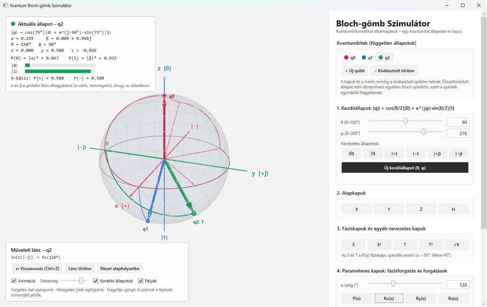
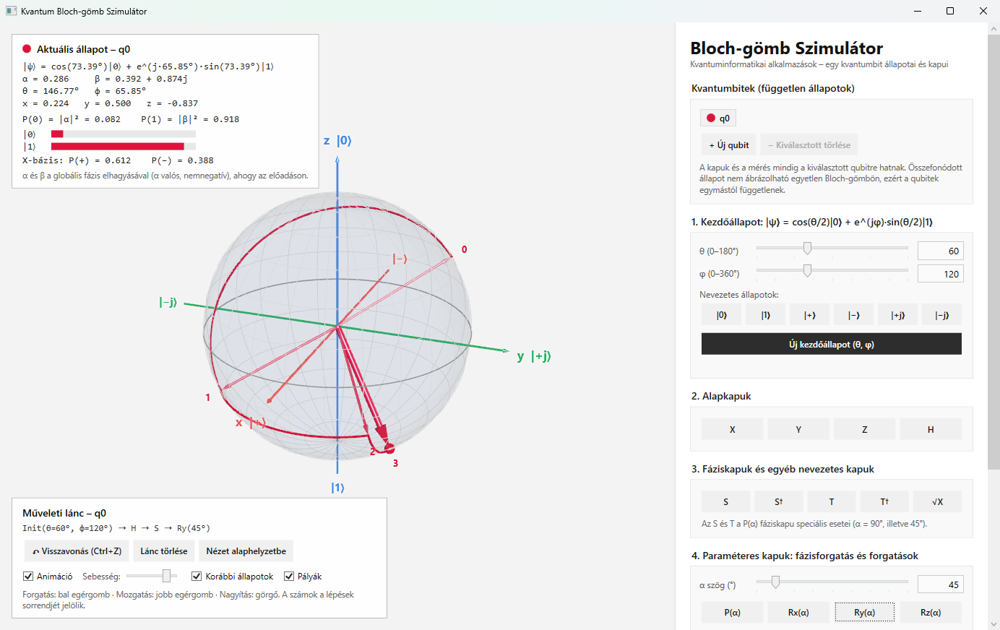
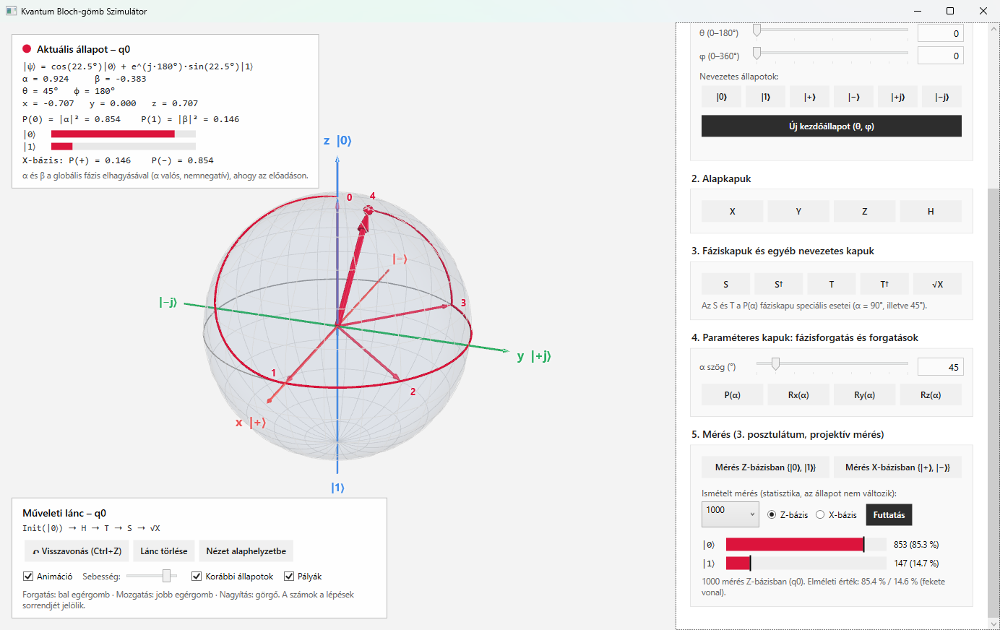

# Bloch-gömb szimulátor

Interaktív 3D Bloch-gömb szimulátor egy vagy több független kvantumbithez (qubithez).
Házi feladat a **Kvantuminformatikai alkalmazások** (BMEVIHIAD00) tárgyhoz, 2026 ősz, 2. feladat.



## Tartalom

- [Funkciók](#funkciók)
- [Gyors kezdés](#gyors-kezdés)
- [Kezelés röviden](#kezelés-röviden)
- [Kapuk](#kapuk)
- [Jelölések és elméleti háttér](#jelölések-és-elméleti-háttér)
- [Fordítás és kiadás](#fordítás-és-kiadás)
- [Projektstruktúra](#projektstruktúra)
- [Tesztek](#tesztek)
- [Dokumentáció](#dokumentáció)
- [Korlátok](#korlátok)
- [Felhasznált könyvtárak](#felhasznált-könyvtárak)
- [English summary](#english-summary)

## Funkciók

- **13 kapu:** X, Y, Z, H, P(α), S, S†, T, T†, √X, Rx(α), Ry(α), Rz(α), tetszőleges (negatív) szöggel is.
- **Animált forgatás:** a Bloch-vektor a kapu forgástengelye körül, a valódi pályán fordul el. A tengelyt
  szaggatott vonal jelzi. Az animáció kikapcsolható, a sebessége állítható.
- **Kapulánc és előzmények:** tetszőleges hosszú lánc, sorszámozott korábbi állapotok és pályák a gömbön,
  visszavonás (Ctrl+Z), lánc törlése.
- **Élő állapotkijelző:** |ψ⟩ képlet, α és β j-s alakban, θ, φ, Bloch-koordináták (x, y, z), P(0) = |α|²,
  P(1) = |β|² sávdiagrammal, X-bázisú valószínűségek.
- **Tetszőleges kezdőállapot:** θ, φ csúszkával vagy pontos (tizedes) számértékkel, illetve hat nevezetes
  állapot gombjával (|0⟩, |1⟩, |+⟩, |−⟩, |+j⟩, |−j⟩).
- **Mérés (3. posztulátum):** projektív mérés Z-bázisban {|0⟩, |1⟩} és X-bázisban {|+⟩, |−⟩}, az állapot
  összeomlásával. Ismételt mérés (100 / 1000 / 10000 „shot”) hisztogrammal és az elméleti értékkel.
- **Több qubit:** legfeljebb 6 független qubit egyszerre, mindegyik saját színnel, lánccal és előzménnyel.
- **Kényelmi funkciók:** átméretezhető ablak, magyarázó buborékok a kapukon (mátrix + geometriai jelentés),
  kamera alaphelyzetbe állítása.

| Kezdőállapot számmal és kapulánc | Mérés hisztogrammal |
|---|---|
|  |  |

## Gyors kezdés

1. Töltsd le a `BlochSphereSimulator.exe` fájlt (a GitHub Releases oldalról vagy a beadott csomagból).
   Ha a forrásból indulsz, a `publish.cmd` a `dist\` mappába készíti el.
2. Indítsd el dupla kattintással. **Nem kell telepíteni semmit**: a .NET 8 futtatókörnyezet bele van
   csomagolva (64 bites Windows 10/11).
3. Ha a Windows SmartScreen figyelmeztet (a fájl nincs digitálisan aláírva):
   „További információ” → „Futtatás mindenképp”.

## Kezelés röviden

| Mit szeretnél? | Hogyan? |
|---|---|
| Forgatni / mozgatni / nagyítani a nézetet | bal egérgomb / jobb egérgomb / görgő |
| Kezdőállapotot megadni | θ, φ csúszka vagy számmező (Enter), vagy a nevezetes állapot gombjai |
| Új kezdőállapot meglévő lánc mellett | „Új kezdőállapot (θ, φ)” gomb (a csúszka nem törli a láncot) |
| Kaput alkalmazni | a 2–4. csoport gombjai, a paraméteres kapuk szöge az „α szög” mezőben |
| Visszalépni | „Visszavonás” vagy Ctrl+Z |
| Mérni | „Mérés Z-bázisban” / „Mérés X-bázisban” |
| Statisztikát nézni | mérésszám + bázis → „Futtatás” |
| Több qubitet összehasonlítani | „+ Új qubit”, majd a listában kiválasztani, melyikre hassanak a kapuk |

**Példa – kvantuminterferométer (előadás):** |0⟩ → H → P(Δα) → H, majd 10000 mérés Z-bázisban.
Az eredmény P(0) = cos²(Δα/2); például Δα = 60° esetén kb. 75% lesz 0.

## Kapuk

| Kapu | Mátrix | Forgatás a Bloch-gömbön |
|---|---|---|
| X | [[0, 1], [1, 0]] | 180° az x tengely körül |
| Y | [[0, −j], [j, 0]] | 180° az y tengely körül |
| Z | [[1, 0], [0, −1]] | 180° a z tengely körül |
| H | 1/√2 · [[1, 1], [1, −1]] | 180° az (x+z)/√2 tengely körül |
| P(α) | [[1, 0], [0, e^(jα)]] | α a z tengely körül |
| S, S† | P(90°), P(−90°) | ±90° a z tengely körül |
| T, T† | P(45°), P(−45°) | ±45° a z tengely körül |
| √X | ½ · [[1+j, 1−j], [1−j, 1+j]] | 90° az x tengely körül |
| Rx(α) | [[cos(α/2), −j·sin(α/2)], [−j·sin(α/2), cos(α/2)]] | α az x tengely körül |
| Ry(α) | [[cos(α/2), −sin(α/2)], [sin(α/2), cos(α/2)]] | α az y tengely körül |
| Rz(α) | [[e^(−jα/2), 0], [0, e^(jα/2)]] | α a z tengely körül |

## Jelölések és elméleti háttér

A program az előadásfóliák jelöléseit követi:

- képzetes egység: **j**; állapot: |ψ⟩ = cos(θ/2)|0⟩ + e^(jφ)·sin(θ/2)|1⟩, 0 ≤ θ ≤ 180°, 0 ≤ φ < 360°
- Bloch-vektor: x = 2·Re(α\*β), y = 2·Im(α\*β), z = |α|² − |β|²; |0⟩ = +z, |1⟩ = −z, |±⟩ = ±x, |±j⟩ = ±y
- a kijelzett α, β a globális fázis elhagyásával jelenik meg (α valós, nemnegatív)
- mérés: P(m) = ⟨ψ|Pₘ|ψ⟩, a mérés utáni állapot Pₘ|ψ⟩ / √P(m)

Részletesen: [docs/BlochSphereSimulator_dokumentacio.pdf](docs/BlochSphereSimulator_dokumentacio.pdf), 4. fejezet.

## Fordítás és kiadás

Szükséges: [.NET 8 SDK](https://dotnet.microsoft.com/download) (vagy újabb), Windows.

```bat
dotnet build BlochSphereSimulator.sln          :: fordítás
dotnet test  BlochSphereSimulator.sln          :: unit tesztek
dotnet run --project BlochSphereSimulator      :: futtatás fejlesztői módban
publish.cmd                                    :: önálló .exe a dist\ mappába
```

A `publish.cmd` a `dotnet publish -c Release -r win-x64` parancsot futtatja; a kiadás beállításai a
[`BlochSphereSimulator.csproj`](BlochSphereSimulator/BlochSphereSimulator.csproj) fájlban vannak.
Így lett az .exe 157 MB helyett **43 MB**, ami elfér a Moodle 50 MB-os korlátjában:

| Lépés | Beállítás | Méret |
|---|---|---|
| önálló, egyfájlos kiadás | `SelfContained`, `PublishSingleFile` | 157 MB |
| tömörítés az .exe-n belül | `EnableCompressionInSingleFile` | 69 MB |
| csak angol keretrendszer-erőforrások | `SatelliteResourceLanguages=en` | 64 MB |
| nem használt kód eltávolítása a .NET alapkönyvtárakból | `PublishTrimmed`, `TrimMode=partial` | 43 MB |

A WPF hivatalosan nem támogatja a trimmelést, ezért a WPF-, XAML-, HelixToolkit- és MathNet-szerelvények
`TrimmerRootAssembly`-ként teljes egészükben megmaradnak, és a `BuiltInComInteropSupport` be van kapcsolva
(a WPF szövegmezői COM-on keresztül érik el a Windows beviteli szolgáltatásait). A kész .exe-t a teljes
felületi forgatókönyv (`tools/shots_scenario.ps1`) végigfuttatásával ellenőriztem.

## Projektstruktúra

```
BlochSphereSimulator/
├─ BlochSphereSimulator/            WPF alkalmazás
│  ├─ Models/QuantumMath.cs         kapuk, állapotok, Bloch-koordináták, mérés, forgatási pályák
│  ├─ Models/QubitTrack.cs          egy qubit lépései (állapot, pálya, tengely), visszavonás
│  ├─ ViewModels/MainViewModel.cs   felületi logika és parancsok (MVVM)
│  ├─ MainWindow.xaml(.cs)          felület, 3D jelenet és animáció
│  └─ Commands/RelayCommand.cs
├─ BlochSphereSimulator.Tests/      MSTest unit tesztek
├─ docs/                            dokumentáció (DOCX, PDF) és képernyőképek
├─ tools/                           dokumentáció- és képernyőkép-generáló szkriptek
└─ publish.cmd                      önálló .exe készítése
```

## Tesztek

35 unit teszt (`dotnet test`), többek között:

- minden kapu unitér; H² = I, S = T², Z = S², √X² = X; a fóliákon szereplő Y, Z, P(α), H hatások
- az animációs pálya végpontja minden kapura megegyezik U|ψ⟩ Bloch-pontjával (13 kapu × 50 véletlen állapot)
- az előadás „tetszőleges állapot előállítása” levezetése és az interferométer a várt állapotot, illetve statisztikát adja
- mérés: Born-szabály, összeomlás, ismételt mérés ugyanazt adja, 100 000 mérés 1%-on belül
- felületlogika: lánc, visszavonás, csúszkák, nevezetes állapotok, mérés, hisztogram, több qubit

## Dokumentáció

- [docs/BlochSphereSimulator_dokumentacio.pdf](docs/BlochSphereSimulator_dokumentacio.pdf) (és `.docx`):
  futtatás, könyvtárak, elméleti háttér, kezelési útmutató képernyőképekkel, megfelelés az értékelési
  szempontoknak, felépítés, tesztelés.
- Újragenerálás: `python tools\build_docs.py`, majd
  `powershell -ExecutionPolicy Bypass -File tools\docx_to_pdf.ps1` (Microsoft Word szükséges).
- A képernyőképek a futó programon: `. .\tools\ui_driver.ps1; . .\tools\shots_scenario.ps1`.

## Korlátok

- Az összefonódott többqubites állapotok (pl. Bell-állapotok) nem bonthatók fel egyqubites állapotok
  szorzatára, így nem ábrázolhatók a Bloch-gömb felszínén. Ezért a qubitek egymástól függetlenek.
- Csak tiszta állapotok; kevert állapotok és zaj (dekoherencia) nincsenek modellezve.

## Felhasznált könyvtárak

| Könyvtár | Verzió | Licenc | Szerep |
|---|---|---|---|
| [.NET 8 / WPF](https://github.com/dotnet/wpf) | 8.0 | MIT | futtatókörnyezet, felület |
| [HelixToolkit.Wpf](https://github.com/helix-toolkit/helix-toolkit) | 3.1.2 | MIT | 3D nézet, kamera, nyilak, feliratok |
| [MathNet.Numerics](https://numerics.mathdotnet.com/) | 5.0.0 | MIT | komplex mátrixok és vektorok |
| [MSTest](https://github.com/microsoft/testfx) | 3.6.2 | MIT | unit tesztek |

## English summary

An interactive 3D Bloch sphere simulator (C#, WPF, .NET 8) for a university homework in quantum information.
It offers 13 single-qubit gates with animated rotations, gate chains with numbered history and undo, a live
state readout, any initial state (sliders, number input, presets), projective measurement in the Z and X bases with a shot histogram, and up to six
independent qubits. Run `publish.cmd` to build a 43 MB self-contained executable; `dotnet test` runs 35 unit tests.
